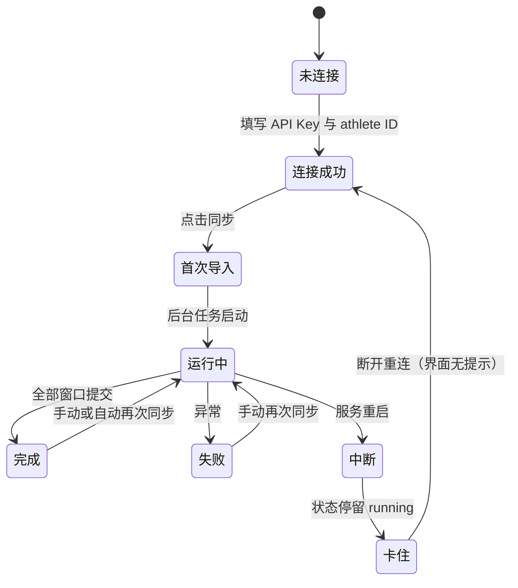

# 同步功能体验走查与修改设计

本文档是体验走查方法的第一个完整样本（方法见 `docs/experience-walkthrough.md`），对象是 Intervals.icu 数据同步。走查方法：列出用户会处于的全部状态，在每个状态回答三个问题——能看到什么、能做什么、出问题怎么恢复。所有结论均经代码核验，附位置。

## 功能现状

以下能力已经存在并且可被用户触达：

- 数据页组件：连接对话框、来源卡片、状态总览、运行历史列表与详情、重算状态、手动导入、导出（`features/data/components/`）。
- 状态总览（`SyncStatusOverview.tsx`）：连接状态、最近一次同步的相对时间与结果徽标、近 10 次运行的活动更新与时序流统计、成功率、手动同步按钮。
- 运行历史（`SyncHistoryList.tsx`、`SyncHistoryDetailDialog.tsx`）：窗口范围、activities_seen / upserted / deduplicated、wellness_seen、streams_inserted、errors_count、error_summary。
- 触发同步后前端每 1.5 秒轮询集成状态，最长 15 分钟，结束后失效全部数据缓存（`useIntegrations.ts` 的 pollSyncUntilSettled、`invalidate-after-sync.ts`）。
- 数据新鲜度：staleness_bucket（fresh / stale / missing）与 data_as_of 随集成状态返回。
- 重复防护：`source_records` 的 payload_hash 去重、secondary duplicate 检测、14 天回看窗口、幽灵活动清理（`intervals/sync.py`、`sync_helpers.py`）。
- 自动同步设置：auto_sync 与 sync_frequency（hourly / daily / manual）经界面保存，`application/integrations/scheduler.py` 有完整实现与测试。

## 状态走查

| 状态 | 能看到什么 | 能做什么 | 出问题怎么恢复 |
|---|---|---|---|
| 未连接 | 连接入口 | 填写凭据连接 | — |
| 连接成功未同步 | 已连接徽标 | 点击同步 | — |
| 首次导入（运行中） | 仅按钮文字"同步中…"，状态与历史无变化 | 等待 | 无 |
| 完成 | 最近同步时间、结果、增量数字 | 查看历史详情 | — |
| 失败 | 结果徽标与错误文字 | 再点一次同步 | 再点一次 |
| 单条流数据失败 | 详情中的 activity_id 与 message | 无 | 再点一次全量同步 |
| 卡住（running 永不结束） | "同步中…"；15 分钟后前端提示超时 | 无有效操作 | 断开重连，界面无任何提示 |
| 依赖自动同步 | 状态卡的新鲜度标记 | 修改设置 | 无（见 G6） |
| 历史早于 30 天 | 无任何说明 | 无 | 无（见 G3） |

## 已验证缺口

### G1 运行中无进度

触发时写入一次空数字的 running 状态，真实计数等结束才写（`integrations.py` 用 `empty_sync_result()` 构建 running detail）。逐月的 `integration_sync_runs` 行在同一个事务里，`_sync_intervals_with_client` 只在最后 `conn.commit()`，长同步过程中其他会话看不到中间行。运行历史卡片自身不轮询（`useSyncRuns` 无 refreshInterval；`useRecomputeStatus` 已有每 2 秒轮询的先例）。用户在整个运行期间能看到的只有按钮文字。

### G2 卡住后无法恢复

同步跑在 uvicorn 进程内的 FastAPI BackgroundTasks 里（`integrations.py` 的 `background_tasks.add_task`）。每次后端部署都执行 `systemctl --user restart running-man-api.service`，重启会终止进行中的同步并把 `last_sync_status` 永久留在 running。之后每次手动同步都返回 409 "sync already running"，界面持续显示"同步中…"；调度器同样按 already_running 跳过该账户（`scheduler.py` 的 collect_targets），自动同步一并失效。没有 watchdog、取消或重置接口，唯一恢复路径是断开重连（`repositories/integrations.py` 的 delete 会清空同步状态字段），界面没有任何提示。前端 15 分钟轮询超时后提示"请稍后刷新查看结果"，但不会有任何结果出现。

### G3 历史范围上限 30 天且不可见

首次同步只拉 `_INITIAL_LOOKBACK_DAYS = 30` 天（`sync.py:48`；`sync_helpers.py` 的 next_sync_date 在无已存活动时返回 today 减 30 天）。wellness 每次固定拉最近 90 天窗口。更早的历史只能用运维侧命令行工具 `apps/api/scripts/backfill.py`（需要 API Key 与数据库 DSN，在服务器上执行），产品界面没有入口。手动按钮文案却是"立即全量/增量同步"，承诺了实际做不到的"全量"。

### G4 单条失败无重试

流数据下载失败会记进运行详情（activity_id 与 message），`sync_activity_streams` 的 force 参数未暴露为接口，运行详情中的失败条目只读。用户对失败活动的恢复手段只有再点一次全量同步。

### G5 按来源数据管理缺失

断开连接只删除 `user_integrations` 行，已同步数据全部保留；没有"清空该来源数据后重来"的流程，也没有针对该来源的任何数据管理操作。

### G6 自动同步承诺未执行

scheduler 实现完整、有测试，但主机上没有任何触发机制接入：systemd user 单元只有两个服务（无 timer），用户 crontab 无相关条目，API lifespan 只启动 recompute worker（`main.py` 的 lifespan）。用户设置"每小时自动同步"后数据不会自动更新，staleness_bucket 最终显示 stale，用户无从知道原因。

## 修改设计

### M1 同步任务持久化与进度

数据模型：新增 `integration_sync_jobs` 表，一次触发的同步对应一个 job：id、athlete_id、source、kind（incremental / backfill）、window_start、window_end、status（queued / running / success / failed / cancelled）、windows_total、windows_done、activities_seen、activities_upserted、streams_inserted、heartbeat_at、created_at、started_at、finished_at、error。`integration_sync_runs` 增加 job_id 列，保留逐窗口记录。每个窗口处理完成立即提交，运行中的进度对其他会话可见。

接口：

- `POST /api/integrations/{source}/sync` 创建 job 并返回 job id；运行状态不再由 `user_integrations.last_sync_status` 承载。
- `GET /api/integrations/{source}/jobs/current` 返回当前 job 与进度。
- `POST /api/integrations/{source}/jobs/{id}/cancel` 置取消请求，执行器在窗口边界响应，终态 cancelled。

执行：job 由独立执行器处理，窗口之间检查取消请求并更新 heartbeat_at。并发守卫改为"存在活动 job 即拒绝"，替代现有 409 判断。

前端：新增 useSyncJobs，running 期间每 2 秒轮询（沿用 `useRecomputeStatus` 模式）；状态总览展示当前窗口范围、已完成窗口数与总数、已见活动数；运行历史按 job 分组展示。

### M2 卡住恢复

- 启动清扫：API 启动时把遗留 running 的 job 标记为 failed，error 写明"服务重启中断"。
- 心跳超时：读取 job 时发现 heartbeat_at 超过 5 分钟无更新即标记 failed 并写明原因。
- 取消入口：状态总览在 running 期间提供取消按钮。
- 调度器的 already_running 跳过逻辑改为检查活动 job，卡住状态不再阻塞自动同步。

### M3 历史范围

- 连接成功后的首次导入界面明确范围：默认最近 30 天，可选"导入更早历史至今"，按月分批执行。
- `POST /api/integrations/{source}/backfill`，参数 from_date，复用 `backfill_activities` 的按月窗口逻辑，纳入 job 进度与取消机制；wellness 历史同路径拉取。
- 数据页展示数据覆盖范围（最早活动日期至最新活动日期），30 天默认值从隐含行为变成可见选择。

### M4 单条重试

- `POST /api/activities/{activity_id}/streams/sync` 以 force 模式重取单个活动的流数据。
- 运行详情中的失败条目直接提供重试按钮，成功后局部刷新该活动的曲线。

### M5 按来源数据管理

- 数据页提供"清空该来源数据"操作：删除该 source 的 activity_summary、activity_streams、source_records 记录，需二次确认；保留连接与凭据。
- 断开连接时提供选择：仅断开，或断开并清空数据。

### M6 文案与实际一致

手动按钮改为"增量同步"；"导入更早数据"入口随 M3 一同提供。前端轮询超时提示指向 job 状态（M1 完成后 job 状态持续可查）。

### M7 自动同步接入触发

为 scheduler 建立 systemd user timer（每 15 分钟一次单次执行，`python -m application.integrations.scheduler` 的 cli 入口；模块已处理并发跳过、失败记录与凭据日志规避）。部署后用日志核对 considered / due / synced / skipped 计数。

## 验收标准

以下场景全部用真实授权账户执行：

| 场景 | 通过标准 |
|---|---|
| 首次连接 | 界面展示将要导入的范围（默认 30 天，可改为更早），确认后开始 |
| 运行中 | 状态总览每数秒刷新：当前窗口、已完成与全部窗口数、已见活动数 |
| 完成 | 数字可与 Intervals.icu 网页核对；重复执行不产生重复活动 |
| 服务重启打断 | job 被标记失败并写明原因；用户可立即重新发起；无永久"同步中" |
| 自动同步 | 设置 hourly 后不操作界面，数据在一小时内自动更新，运行历史留有记录 |
| 历史补充 | 从任意更早月份发起导入，完成后分析页统计覆盖该时段 |
| 单条流失败 | 详情可见失败条目，重试后补齐，无需全量重跑 |
| 数据管理 | 清空来源后活动列表为空，重新同步可完整恢复 |
| 文案 | 按钮与提示描述的行为与实际执行一致 |

对应设计文档阶段一验收条款："使用真实授权账户完成导入"、"重复同步不产生重复统计"、"修改、删除和同步失败得到正确处理"。
